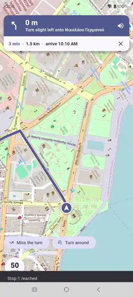
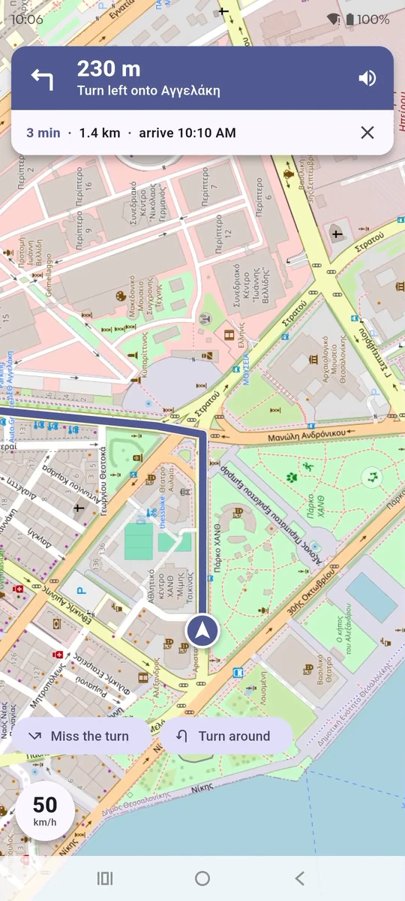
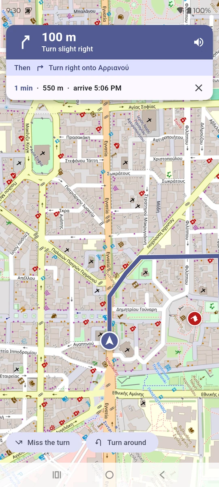
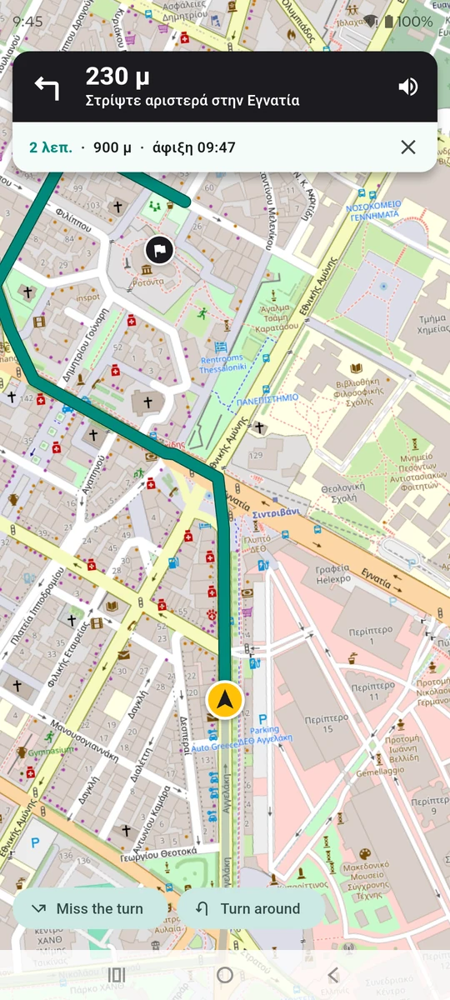
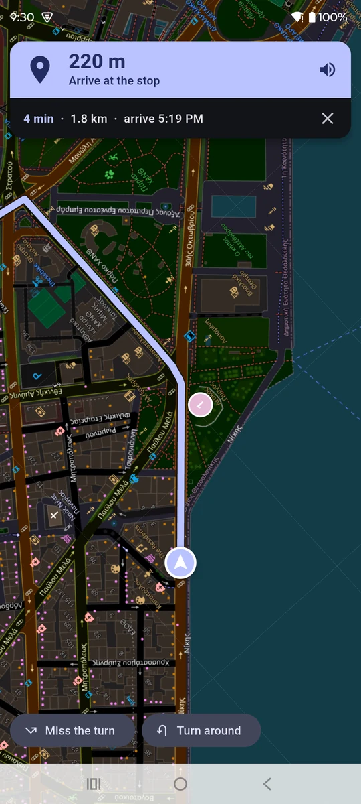
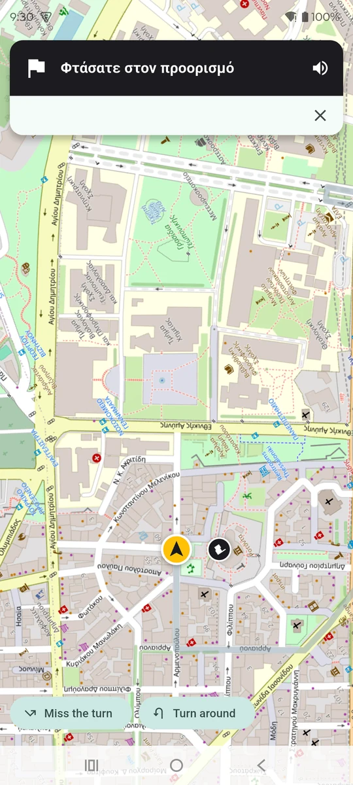

# flutter_osrm_navigation

Turn-by-turn navigation for [flutter_map](https://pub.dev/packages/flutter_map), on top of any [OSRM](https://project-osrm.org) or [Valhalla](https://github.com/valhalla/valhalla) server. No API keys, no per request billing, your own routing server if you want one.

It follows the car along the route line, speaks each maneuver, notices when you leave the route (a wrong turn, driving the wrong way, a missed U-turn) and asks the router for a new route that starts the way you are heading. Every color of the banner, the route line and the position marker can be changed.

<p align="center">
  
</p>

<p>
  
  
  
  
  
</p>

## Features

- **Turn-by-turn on the route line.** Distance to the next maneuver and the time left are measured along the road, the part already driven drops off the map.
- **Voice prompts** far, near and at the maneuver, earlier at speed, with the next one when it comes right after ("Turn left, then turn right onto Main Street").
- **Rerouting** when off the line, driving the wrong way, or past a U-turn you did not take. One request at a time, a backoff after failures, the old route stays until a new one arrives. GPS noise, tunnels, red lights, jumps and the ends of the route are handled so it does not reroute for nothing.
- **Stops on the way.** Routes through several points, each stop announced and reported, reroutes go through the stops not reached yet.
- **OSRM, Valhalla, or your own backend.** Built in routers for both, or hand over routes from your server in OSRM's shape.
- **Live ETA.** The time left is corrected now and then from the router (traffic, when your router knows it).
- **A ready map.** `NavigationMap` with a camera that turns with the road, zooms with speed, keeps the car low on the screen, glides between fixes, and comes back after you pan. The current speed (km/h or mph) with the speed limit sign when the router sends limits, and the GPS accuracy circle, are on by default, each one a switch.
- **Your colors.** `NavigationStyle` is a theme extension. Out of the box everything follows your `ColorScheme`.
- **Background.** Keeps navigating and speaking with the app in the background or the screen off.
- **Seven languages built in** (English, Greek, Bulgarian, German, French, Spanish, Italian), picked from the app locale in one line, metric or imperial, and any other language by overriding the words and registering it.
- **A simulator** to drive a route from your desk.

## Getting started

```yaml
dependencies:
  flutter_osrm_navigation: ^0.2.2
```

## Quick start

```dart
import 'package:flutter/material.dart';
import 'package:flutter_map/flutter_map.dart';
import 'package:flutter_osrm_navigation/flutter_osrm_navigation.dart';
import 'package:latlong2/latlong.dart';

class NavigationScreen extends StatefulWidget {
  const NavigationScreen({super.key});

  @override
  State<NavigationScreen> createState() => _NavigationScreenState();
}

class _NavigationScreenState extends State<NavigationScreen> {
  final controller = NavigationController(
    router: OsrmRouter(baseUrl: 'https://your-osrm-server.example.com'),
  );

  @override
  void initState() {
    super.initState();
    controller.initVoice();
    _start();
  }

  Future<void> _start() async {
    if (await NavigationLocation.ensurePermission() != LocationAccess.granted) {
      return;
    }
    controller.attachLocation(NavigationLocation.stream());
  }

  @override
  void dispose() {
    controller.dispose();
    super.dispose();
  }

  @override
  Widget build(BuildContext context) {
    return Scaffold(
      body: NavigationMap(
        controller: controller,
        layers: [
          TileLayer(
            urlTemplate: 'https://tile.openstreetmap.org/{z}/{x}/{y}.png',
            userAgentPackageName: 'com.example.app',
          ),
        ],
        onLongPress: (_, point) => controller.navigateTo(point),
      ),
    );
  }
}
```

`navigateTo` starts from the last GPS fix, and when the car is moving the route starts the way it is heading. Pass `from` to start somewhere else and `via` for stops on the way:

```dart
await controller.navigateTo(
  destination,
  via: [firstStop, secondStop],
  destinationName: 'Home', // "Navigating to Home"
);
```

Stops can change on the way. Each change is a new route from where the car is, the way it is heading, through the stops not reached yet, to the same destination:

```dart
await controller.addWaypoint(newStop);            // last of the stops
await controller.addWaypoint(newStop, index: 0);  // or the next one
await controller.removeWaypoint(0);               // index in remainingWaypoints
```

It comes through `events` as `Rerouted`, and "Navigating to" is not said again. When the router has no route the old one stays and the call throws.

## Routers

### OSRM

```dart
OsrmRouter(
  baseUrl: 'https://your-osrm-server.example.com',
  profile: 'driving',
  queryParameters: {'exclude': 'toll'},
)
```

The default `baseUrl` is OSRM's public demo server. It works for trying things out, but it has a strict usage policy and no uptime promise, so use your own server for anything real.

### Valhalla

```dart
ValhallaRouter(
  baseUrl: 'https://your-valhalla-server.example.com',
  costing: 'auto', // or taxi, bus, truck, motor_scooter, bicycle, pedestrian
  costingOptions: {'auto': {'use_highways': 0.3}},
)
```

It asks Valhalla for OSRM's response shape, so both routers give the same `NavRoute`.

### Your own backend

When routes come through your server (to keep the router private, add auth, cache), use `CallbackRouter` and parse the answer with `NavRoute.fromOsrmJson`. It takes a whole OSRM response or a single route, with the line as a polyline (precision 5 or 6, worked out on its own) or GeoJSON.

```dart
final router = CallbackRouter(
  route: (request) async {
    final json = await myApi.directions(
      points: request.points,
      heading: request.headingDeg,
    );
    return NavRoute.fromOsrmJson(json);
  },
  // Optional: seconds left, for the live ETA.
  eta: (request) async => myApi.secondsLeft(request.points),
);
```

A router that has no route throws a `RoutingException`.

### Keys, tokens and headers

A server behind a key or a login takes headers. `headers` are the same on every request, `headersBuilder` is asked before every request, for a token that expires:

```dart
OsrmRouter(
  baseUrl: 'https://your-osrm-server.example.com',
  headers: {'X-Api-Key': 'your-key'},
  headersBuilder: () async => {
    'Authorization': 'Bearer ${await auth.freshToken()}',
  },
)

// Hosted Valhalla that wants the key in the URL
ValhallaRouter(
  baseUrl: 'https://valhalla.example.com',
  queryParameters: {'api_key': 'your-key'},
)
```

OSRM takes `queryParameters` too. Keep keys out of source you push, pass them with `--dart-define` or from your backend.

### More than one server

Give a router backup servers and it moves to the next one when a server is down, too slow, rate limited or failing:

```dart
OsrmRouter(
  baseUrl: 'https://osrm-1.example.com',
  fallbackUrls: ['https://osrm-2.example.com', 'https://osrm-3.example.com'],
  retryMainAfter: const Duration(minutes: 5), // the default
)
```

After a fallback, requests stay on the server that answered, so a dead one does not cost a timeout every time. The first server is tried again after `retryMainAfter`. `router.currentUrl` says which one is in use. "No route between these points" is not asked elsewhere, the same map data would say the same.

`ValhallaRouter` takes `fallbackUrls` too. To mix kinds, say your own Valhalla first and OSRM behind it, chain them:

```dart
FallbackRouter([
  ValhallaRouter(baseUrl: 'https://valhalla.example.com'),
  OsrmRouter(baseUrl: 'https://osrm.example.com'),
])
```

`FallbackRouter(..., onNoRoute: true)` also asks the next one when a router finds no route, for routers with different map data.

### Rate limits

Public servers (the OSRM demo allows about one request a second) answer HTTP 429 when asked too often. The package does not make it worse:

- A 429 or a server error (5xx) is not retried on the spot. The error says `isRateLimited` or `isServerError` and has the server's `retryAfter`.
- While navigating, the old route stays on screen and the next reroute waits 15, 30, 60 and at most 120 seconds, or as long as the server's `Retry-After` asks, whichever is longer. Never more than one request at a time.
- The ETA refresh (every 2 minutes) waits too.
- `navigateTo` throws, so your app decides:

```dart
try {
  await controller.navigateTo(destination);
} on RoutingException catch (e) {
  if (e.isRateLimited) {
    showMessage('Busy, try again in ${e.retryAfter?.inSeconds ?? 30} s');
  } else {
    showMessage(e.message);
  }
}
```

## Colors

Everything takes its colors from your theme. To change some, add a `NavigationStyle` to the theme:

```dart
MaterialApp(
  theme: ThemeData(
    colorSchemeSeed: Colors.teal,
    extensions: const [
      NavigationStyle(
        bannerColor: Color(0xFF1B1B1F),
        onBannerColor: Colors.white,
        routeColor: Color(0xFF00897B),
        routeWidth: 10,
        traveledColor: Color(0x8890A4AE),
        puckColor: Color(0xFFFFC107),
      ),
    ],
  ),
)
```

or pass one to a widget, which wins over the theme:

```dart
NavigationMap(
  controller: controller,
  style: const NavigationStyle(routeColor: Colors.deepPurple),
  layers: [...],
)
```

| Part | Fields |
|------|--------|
| Banner | `bannerColor`, `onBannerColor`, `bannerBorderRadius`, `bannerElevation`, `distanceTextStyle`, `instructionTextStyle` |
| "Then" row | `thenColor`, `onThenColor` |
| Off route row | `offRouteColor`, `onOffRouteColor` |
| Tap for voice row (web) | `voiceTapColor`, `onVoiceTapColor` |
| Footer | `footerColor`, `onFooterColor`, `footerAccentColor`, `footerMutedColor`, `footerTextStyle` |
| Route line | `routeColor`, `routeBorderColor`, `routeWidth`, `routeBorderWidth`, `traveledColor`, `offRouteLineColor` |
| Position | `puckColor`, `puckBorderColor`, `puckArrowColor`, `puckSize`, `accuracyColor` |
| Markers | `destinationColor`, `stopColor`, `onMarkerColor` |
| Buttons | `buttonColor`, `onButtonColor` |
| Speed | `speedColor`, `onSpeedColor`, `speedingColor`, `onSpeedingColor`, `speedLimitColor` |

For your own marker use `NavigationMap(positionMarker: ...)`, drawn pointing up. For your own maneuver icons use `NavigationBanner(iconBuilder: ...)`.

### What the map shows

Each part is a switch on `NavigationMap`:

```dart
NavigationMap(
  controller: controller,
  showBanner: true,          // the next maneuver, time and distance left
  showSpeed: true,           // current speed, km/h or mph by settings.units
  showSpeedLimit: true,      // the limit sign next to it, when the router sent limits
  speedAlignment: AlignmentDirectional.bottomStart,
  showAccuracy: true,        // GPS accuracy circle (hidden while drawn on the route)
  showStops: true,           // numbered stops and the destination flag
  showRecenterButton: true,  // after the user pans the map
  headingUp: true,
  autoZoom: true,
  layers: [...],
)
```

### When not navigating

The same map works with no route at all, following the position the way it does while navigating. Each part can be turned back:

```dart
NavigationMap(
  controller: controller,
  idleHeadingUp: true,            // turn with the direction of travel above
                                  // settings.headingKmh, hold the rotation below
  idleFollowLikeNavigation: true, // zoom with the speed, car low on the screen
  recenterWhenIdle: true,         // follow again recenterAfter after a pan
  speedOnlyWhileNavigating: false, // the speed shows whenever there is a fix
  layers: [...],
)
```

To move the camera to a place, say to show where someone is waiting, call `showPoint` through a key. Following stops, the re-center button shows, and following comes back after `recenterAfter` or with the button:

```dart
final mapKey = GlobalKey<NavigationMapState>();

mapKey.currentState?.showPoint(const LatLng(40.6403, 22.9439), zoom: 16);
```

Your own widgets for the stops and the destination, and a say when the camera stops or starts following:

```dart
final mapKey = GlobalKey<NavigationMapState>();

NavigationMap(
  key: mapKey,
  controller: controller,
  stopBuilder: (context, index, point) => MyStopPin(number: index + 1),
  destinationBuilder: (context, point) => const MyFlag(),
  positionMarker: const MyCar(), // drawn pointing up, turned with the heading
  onFollowingChanged: (following) {
    // false when the user moved the map, true when it follows again
  },
  layers: [...],
)

// From a button of your own:
mapKey.currentState?.recenter();
```

Stop and destination markers, yours included, stay upright when the map turns with the road. They need no turning back of their own.

Each part also takes its own place and spacing, inside the safe area, for when your app has buttons or a panel over the map:

```dart
NavigationMap(
  controller: controller,
  bannerPadding: const EdgeInsets.fromLTRB(12, 8, 12, 0),
  bannerMaxWidth: 560,
  speedAlignment: AlignmentDirectional.bottomStart,
  speedPadding: const EdgeInsets.only(left: 16, bottom: 88), // above your buttons
  recenterAlignment: AlignmentDirectional.bottomEnd,
  recenterPadding: const EdgeInsets.all(16),
  // Pushes all three in together, the height of your bottom panel say.
  overlayInsets: EdgeInsets.only(bottom: panelHeight),
  layers: [...],
)
```

`positionAt` and `overlayInsets` can change at any time, with a panel the user drags say: the camera moves to the new place at once, not at the next fix.

`crs` and `cameraConstraint` go to flutter_map as they are, for a projection of your own (one that does not repeat the world, say) or a camera kept inside an area. Without them the map is flutter_map's default.

The speed follows the units and the language: `km/h` in English, `χλμ/ώ` in Greek, `mph` with `DistanceUnits.imperial`. `NavigationSpeedometer(controller: controller)` is the same badge for your own layout.
It also works with no route at all, from a controller you only feed fixes: `NavigationSpeedometer(controller: controller, onlyWhileNavigating: false)`.

### Speed limits

When the route comes with limits, a round sign shows next to the speed and the speed turns red while over it (by more than `settings.speedingToleranceKmh`, 3 by default). Without limits only the speed shows.

Limits come from a `maxspeed` annotation on the route, the way Mapbox compatible servers send it. Plain OSRM (and its public demo) does not have it, so `OsrmRouter` only asks for it when told to:

```dart
OsrmRouter(baseUrl: 'https://your-server.example.com', speedLimits: true)
```

A server that turns the option down is asked again without it, once. Routes from Valhalla or your own backend through `CallbackRouter` that carry `annotation.maxspeed` are read either way. The controller has `speedLimitKmh`, `speeding` and a `SpeedLimitChanged` event for your own UI.

## Language and units

Built in: English, Greek, Bulgarian, German, French, Spanish and Italian. Each one has its own voice (`bg-BG`, `de-DE`...), decimal comma or point, clock, and speed unit (`км/ч` in Bulgarian).

The easy way is the app's or the phone's language:

```dart
// From the app
controller.strings = NavigationStrings.forLocale(Localizations.localeOf(context));

// From the phone
controller.strings = NavigationStrings.forLocale(PlatformDispatcher.instance.locale);

// Or by code
controller.strings = NavigationStrings.forLanguage('bg');
controller.strings = const BulgarianNavigationStrings(); // same thing

controller.settings = controller.settings.copyWith(units: DistanceUnits.imperial);
```

A language with nothing built in falls back to English. The arrival time in the banner follows the navigation language, not the app's: 24 hour in most of Europe, the phone's setting in English (`clockTime`).

### A language of your own

Extend `EnglishNavigationStrings` and override the words, then register it once, so `forLanguage` and `forLocale` find it like a built in one. The instruction text is built from small pieces (`turn`, `keep`, `roundabout`, `onStreet`, `inDistance`...), so a language is mostly a list of short strings. Anything you leave out stays English, so you can start with a few and fill in the rest. Set `speechLanguage` to the voice's language:

```dart
class RomanianNavigationStrings extends EnglishNavigationStrings {
  const RomanianNavigationStrings();

  @override
  String get speechLanguage => 'ro-RO';

  @override
  String get decimalSeparator => ',';

  @override
  String direction(String modifier) => switch (modifier) {
        'left' => 'la stânga',
        'right' => 'la dreapta',
        _ => super.direction(modifier),
      };

  @override
  String turn(String direction) => 'Virați $direction';

  @override
  String inDistance(String distance, String instruction) =>
      'După $distance, ${NavigationStrings.lowerFirst(instruction)}';

  @override
  String metersSpoken(int meters) => '$meters de metri';

  // ...
}

void main() {
  NavigationStrings.register('ro', () => const RomanianNavigationStrings());
  runApp(const MyApp());
}
```

`register` also takes a country (`'pt-BR'`), and can replace the wording of a built in language. The built in ones were written carefully but are not all checked by native speakers, so corrections are welcome as issues or pull requests.

## Background

The controller is plain Dart that runs on the fixes it gets, so it keeps navigating and speaking with the app in the background for as long as the platform keeps sending locations. `NavigationLocation.stream()` sets that up.

### Android

Add to `android/app/src/main/AndroidManifest.xml`:

```xml
<uses-permission android:name="android.permission.INTERNET"/>
<uses-permission android:name="android.permission.ACCESS_FINE_LOCATION"/>
<uses-permission android:name="android.permission.ACCESS_COARSE_LOCATION"/>
<uses-permission android:name="android.permission.FOREGROUND_SERVICE"/>
<uses-permission android:name="android.permission.FOREGROUND_SERVICE_LOCATION"/>
<uses-permission android:name="android.permission.POST_NOTIFICATIONS"/>
<uses-permission android:name="android.permission.WAKE_LOCK"/>

<queries>
    <!-- The voice, on Android 11 and up. -->
    <intent>
        <action android:name="android.intent.action.TTS_SERVICE"/>
    </intent>
</queries>
```

While the stream is listened to it runs as a foreground service of type location with a notification, so fixes keep coming and the voice keeps talking with the app in the background or the screen off. It only needs the "while using the app" location permission, as long as the stream starts while the app is on screen. "Allow all the time" is not needed.

```dart
NavigationLocation.stream(
  notificationTitle: 'Navigating',
  notificationText: 'Directions to Home are on',
  notificationIcon: const AndroidResource(name: 'ic_notification'), // res/drawable
)
```

A few things worth knowing, all seen on a real Android 15 phone:

- **Notification permission.** On Android 13 and up `POST_NOTIFICATIONS` is a runtime permission. The service runs without it, but its notification only shows once the user allows notifications. Ask for it with [permission_handler](https://pub.dev/packages/permission_handler) (`Permission.notification.request()`) before you start navigating.
- **Music ducking.** Android 15 only gives audio focus to apps that are on screen or running a foreground service. With the location stream running, prompts lower the music in the background too. Without it (say you feed fixes from somewhere else) the prompts still play, just over the music.
- **Google Play.** An app with a location foreground service has to declare it in the Play Console (App content, foreground service permissions). Navigation is an accepted use, describe it as turn-by-turn directions.
- **Battery savers.** Some makers (Xiaomi, Huawei, Samsung's sleeping apps) stop foreground services on their own. If users report navigation stopping in the background, point them at [dontkillmyapp.com](https://dontkillmyapp.com).

### iOS

Add to `ios/Runner/Info.plist`:

```xml
<key>NSLocationWhenInUseUsageDescription</key>
<string>Your location is used to guide you along the route.</string>
<key>NSLocationAlwaysAndWhenInUseUsageDescription</key>
<string>Your location is used to keep guiding you in the background.</string>
<key>UIBackgroundModes</key>
<array>
    <string>audio</string>
    <string>location</string>
</array>
```

`location` keeps fixes coming in the background (with the blue indicator in the status bar), `audio` lets the voice speak there. The voice plays over music, which ducks while it talks, and with the ringer switch off. "While using the app" is enough, iOS keeps background updates going for an app that started them on screen and has the `location` background mode. When an app goes to the App Store, the review asks why it needs background location. Turn-by-turn navigation is the textbook answer.

iOS has no notification for location in the background, only the blue indicator. To show the next turn outside the app, see below.

### Keeping the screen on

Navigation apps usually keep the screen on while navigating. Use [wakelock_plus](https://pub.dev/packages/wakelock_plus) with the controller:

```dart
controller.addListener(() {
  controller.isActive ? WakelockPlus.enable() : WakelockPlus.disable();
});
```

### The next turn outside the app

The package keeps navigating in the background and tells you everything through `controller.events`. What shows outside the app is up to your app, the same events feed both platforms:

| Event | What to do |
|---|---|
| `NavigationStarted` | Show the notification, start the Live Activity |
| `StepChanged` | A new next turn: `controller.upcomingInstruction`, `controller.upcomingStep` |
| `ProgressUpdated` | Every fix: `distanceToNextStep`, `remainingDistance`, `remainingDuration`. Update only when the shown text changes |
| `EtaUpdated` | The arrival time changed: `controller.estimatedArrival` |
| `RerouteStarted`, `Rerouted` | "Recalculating", then the new turn |
| `NavigationStopped`, `DestinationReached` | Take it all away |

Use `controller.strings` (`shortDistance`, `shortDuration`, `arrivalTime`, `clockTime`) for the text, so it reads like the banner, in the same language.

**Android.** The location service's notification is required by Android and set when the stream starts, it does not change while it runs. For the next turn, post an ongoing notification of your own and update it:

```dart
String? shown;

void showTurn(NavigationEvent event) {
  final s = controller.strings;
  final distance =
      s.shortDistance(controller.distanceToNextStep, controller.settings.units);
  final title = '$distance · ${controller.upcomingInstruction ?? ''}';
  if (title == shown) return; // nothing new to show
  shown = title;
  final eta = controller.estimatedArrival;
  notifications.show(
    1,
    title,
    eta == null ? null : s.arrivalTime(s.clockTime(eta, use24h: true)),
    const NotificationDetails(
      android: AndroidNotificationDetails(
        'navigation', 'Navigation',
        ongoing: true, onlyAlertOnce: true, importance: Importance.low,
      ),
      iOS: DarwinNotificationDetails(
        presentSound: false,
        interruptionLevel: InterruptionLevel.passive,
      ),
    ),
  );
}

controller.events.listen((event) {
  switch (event) {
    case StepChanged() || ProgressUpdated() || EtaUpdated() || Rerouted():
      showTurn(event);
    case NavigationStopped() || DestinationReached():
      shown = null;
      notifications.cancel(1);
    default:
  }
});
```

That is [flutter_local_notifications](https://pub.dev/packages/flutter_local_notifications). `onlyAlertOnce` and the check on the text keep it from buzzing or posting every second, Android slows down apps that post too often. It sits next to the location notification, Android does not let an app change that one.

**iOS.** There is no ongoing notification on iOS, so the same code shows a new quiet notification for each turn (`passive` keeps it from lighting the screen). The way iOS apps show live directions is a Live Activity, on the lock screen and in the Dynamic Island. It is a small SwiftUI widget extension in your app, fed from the same events, with a package such as [live_activities](https://pub.dev/packages/live_activities). While navigating the app runs in the background (the `location` mode), so it can update the activity itself.

SwiftUI has no Material icons. Send `upcomingStep.maneuverType` and `upcomingStep.modifier` and pick an SF Symbol in the widget:

| `modifier` | SF Symbol |
|---|---|
| `left`, `right` | `arrow.turn.up.left`, `arrow.turn.up.right` |
| `slight left`, `slight right` | `arrow.up.left`, `arrow.up.right` |
| `sharp left`, `sharp right` | `arrow.turn.left.down`, `arrow.turn.right.down` |
| `uturn` | `arrow.uturn.down` |
| `straight` | `arrow.up` |
| roundabouts (`maneuverType`) | `arrow.triangle.turn.up.right.circle` |
| `arrive` (`maneuverType`) | `flag.checkered` |

## The voice

`TtsNavigationVoice` (the default) uses the device's text to speech: [flutter_tts](https://pub.dev/packages/flutter_tts) on phones and desktops, the browser's own speech on the web (which also keeps the package WebAssembly ready). On Android it uses the navigation audio stream and ducks other audio. When the device has no voice for the language it says so (`controller.voiceState == VoiceState.unavailable`) rather than reading the text with the wrong voice.

Browsers only speak after the page had a tap. The first tap anywhere unlocks the voice, and until then the banner shows a "Tap for voice" row.

Mute and unmute with `controller.voiceEnabled`.

Alerts of your own go through the same voice, language and mute:

```dart
controller.say('Speed camera in 300 meters');
controller.say('Road closed ahead', interrupt: true);
```

`say` keeps quiet for `settings.speakGapMs` after a prompt so it does not cut a turn off, unless `interrupt` is true. It returns whether it spoke, and comes through `events` as `InstructionSpoken` like the prompts. To send prompts somewhere else implement `NavigationVoice`, or use `SilentNavigationVoice` to keep them quiet.

### When the voice is missing

`controller.voiceProblem` says why the voice cannot speak, or may not speak well:

| `VoiceProblem` | What it means | What the user can do |
|---|---|---|
| `none` | All good | |
| `noEngine` | No text to speech app on the phone (Android) | Install Google's Speech Services |
| `languageMissing` | The engine has no voice for the language | Add the voice in the text to speech settings |
| `notDownloaded` | The voice is there but not downloaded (Android). It speaks only while online | Download it in the text to speech settings |
| `unsupportedPlatform` | No speech here (Linux, Windows, an old browser) | |

The package does not open system screens itself, so it stays plain Dart on every platform. On Android it takes a few lines with [android_intent_plus](https://pub.dev/packages/android_intent_plus), then `recheckVoice` when the user comes back:

```dart
import 'package:android_intent_plus/android_intent.dart';

Future<void> fixVoice() async {
  switch (controller.voiceProblem) {
    case VoiceProblem.noEngine:
      await const AndroidIntent(
        action: 'action_view',
        data: 'market://details?id=com.google.android.tts',
      ).launch();
    case VoiceProblem.languageMissing:
    case VoiceProblem.notDownloaded:
      // The engine's own "install voice data" screen.
      await const AndroidIntent(
        action: 'android.speech.tts.engine.INSTALL_TTS_DATA',
      ).launch();
    default:
  }
}

// Look again when the app comes back to the front.
final listener = AppLifecycleListener(onResume: controller.recheckVoice);
```

On iOS voices are added by the user in Settings, Accessibility, Spoken Content, Voices. There is no screen an app can open for it, so tell the user where to go.

## When location is not right

| Case | What you get | What to do |
|---|---|---|
| Location switched off | `LocationAccess.serviceDisabled` | `NavigationLocation.openLocationSettings()` |
| Permission refused | `LocationAccess.denied` | Ask again later |
| Refused for good | `LocationAccess.deniedForever` | `NavigationLocation.openSettings()` |
| "Precise" turned off (Android 12+, iOS 14+) | `LocationAccess.approximate` | Ask for precise location in the app settings. Fixes are kilometres off and navigation leaves them all out |
| Permission taken away or GPS off while driving | An error on the stream, to `attachLocation(onError: ...)` | The route and progress stay, navigation picks up when fixes come back |
| No fix for a while (a garage, a long tunnel) | `controller.gpsSignal == GpsSignal.lost`, `GpsSignalChanged`, "Searching for GPS…" in the banner | Nothing, it clears with the next fix |
| Fixes come but are all too rough | `GpsSignal.weak`, "Weak GPS signal" in the banner | Usually approximate location, see above |

On iOS, `ensurePermission(iosPrecisePurposeKey: 'Navigation')` asks iOS for precise location for the session first, when Info.plist has the key:

```xml
<key>NSLocationTemporaryUsageDescriptionDictionary</key>
<dict>
    <key>Navigation</key>
    <string>Turn-by-turn directions need your precise location.</string>
</dict>
```

How long without a fix counts as lost is `settings.gpsLostSeconds` (10, 0 turns it off). `NavigationMap` and `NavigationBanner` check it every second. Without them, call `controller.checkGps()` on a timer of your own.

## Events

```dart
controller.events.listen((event) {
  switch (event) {
    case WaypointReached(:final index):
      print('stop ${index + 1} reached');
    case DestinationReached():
      print('arrived');
    case Rerouted(:final route):
      print('new route, ${route.distanceM} m');
    case RerouteFailed(:final error):
      print('no new route yet: $error');
    default:
  }
});
```

Also `NavigationStarted`, `NavigationStopped`, `OffRouteChanged`, `RerouteStarted` (a new route is being asked for, the banner shows "Recalculating"), `SpeedLimitChanged`, `GpsSignalChanged` and `InstructionSpoken`. Following the position on the map is `NavigationMap(onFollowingChanged: ...)`.

For distance and time:

```dart
controller.events.listen((event) {
  switch (event) {
    case ProgressUpdated(:final remainingDistance, :final remainingDuration):
      // after every GPS fix that counted, also distanceToNextStep,
      // position, speedMps and estimatedArrival
      print('${remainingDistance.round()} m, ${remainingDuration.inMinutes} min left');
    case StepChanged(:final step):
      print('next: ${controller.upcomingInstruction}');
    case EtaUpdated(:final estimatedArrival):
      print('router corrected the arrival to $estimatedArrival');
    default:
  }
});
``` The same state is on the controller for your UI: `recalculating`, `offRoute`, `arrived`.

## Your own UI

`NavigationMap` is a convenience. The pieces work on their own in any `FlutterMap`:

```dart
FlutterMap(
  options: const MapOptions(),
  children: [
    TileLayer(urlTemplate: '...'),
    NavigationRouteLayer(controller: controller),
    NavigationStopsLayer(controller: controller),
    ListenableBuilder(
      listenable: controller,
      builder: (context, _) => NavigationPositionLayer(
        position: controller.displayPosition,
        heading: controller.displayHeading,
      ),
    ),
  ],
)
```

and `NavigationBanner(controller: controller)` and `NavigationSpeedometer(controller: controller)` anywhere in your layout. If you animate the marker yourself, pass `progressMeters` to `NavigationRouteLayer` so the line ends right at it. Or skip the widgets and read the controller: `upcomingInstruction`, `distanceToNextStep`, `thenInstruction`, `remainingDistance`, `remainingDuration`, `estimatedArrival`, `remainingLine`, `offRoute`, `recalculating`, `arrived`, and `NavigationStyle.resolve(context)` for the colors.

## Settings

Every threshold is in `NavigationSettings` and can be changed while navigating:

```dart
controller.settings = const NavigationSettings(
  offRouteMeters: 40,       // off the route this far from the line
  offRouteFixes: 3,         // for this many fixes in a row
  rerouteMinSeconds: 15,    // at most one new route this often
  promptFarMeters: 800,     // "In 800 meters, turn left"
  promptNearMeters: 200,
  arriveMeters: 30,
  snapMeters: 25,           // draw the car on the line this close to it
  etaRefreshSeconds: 120,   // ask the router for the time left
);
```

## Try it at your desk

```dart
final simulator = RouteSimulator(controller, speedKmh: 50);
await controller.navigateTo(destination, from: start);
simulator.start();

simulator.missTurn();   // goes straight on, off the route
simulator.turnAround(); // drives back along the route, the wrong way
```

It drives the route, follows reroutes, and stops at the end. `missTurn` and `turnAround` are there to watch the rerouting: the controller says "Recalculating the route", asks the router for a new route that starts the way the car is going, and the simulator carries on along it. Do not feed real fixes at the same time. `start` forgets the recent real fixes (`controller.resetFixHistory()`), so a simulation that starts a block away from the last GPS position is not taken for a GPS jump.

The example app has buttons for all of this.

## Platforms

| | Routing and navigation | Voice | Background |
|---|---|---|---|
| Android | Yes | Yes | Yes |
| iOS | Yes | Yes | Yes |
| Web | Yes | After a first tap | No |
| macOS | Yes | Yes | No |
| Windows, Linux | Yes | No | No |

Android and iOS are the tested targets.

## License

MIT, see [LICENSE](LICENSE).
